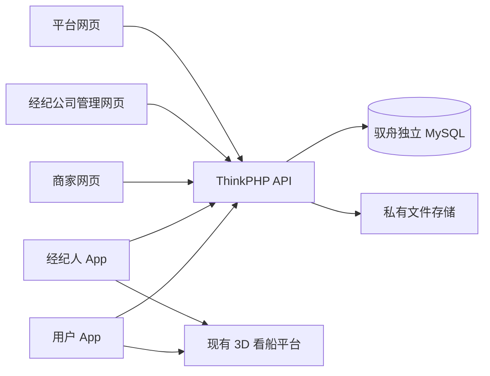

# 驭舟架构与参考

## 已确认的系统边界

用户端和经纪人销售端为两个独立安装包，支持 iOS/Android。商家、经纪公司管理和平台为三个网页入口。界面及业务导航参考交付视频，后续确认需求优先于合同旧版本。前后端通过版本化 `/api/v1` JSON 接口分离；全部权限、报价、库存和金额校验在服务器执行。

初期沿用同一台阿里云的 Nginx、PHP 7.2 与 MySQL 5.7，使用独立域名、数据库账号、上传目录和运行目录。前端编译后的静态文件由 Nginx 提供；框架版本与现有阿里云 App.php 哈希已核对一致，不复制原项目的业务代码、客户数据或支付密钥。

## 参考项目

| 项目 | 采用范围 | 原因 |
|---|---|---|
| [DCloud UniApp](https://github.com/dcloudio/uni-app/tree/uni-app-vue3) | 两个 App 的 Vue 3 跨端框架与原生资源构建 | 与提供的视频原型及 HBuilderX 工具链对应 |
| [Vue](https://github.com/vuejs/core) | 三个管理入口的组件、状态和路由 | 与 App 技术栈一致，减少重复实现 |
| [现有定制 ThinkPHP](https://github.com/xuefeiniao/framework) | API 框架，锁定现有提交 8f8e7c0bf37baf86f0762b17c06291d6dab29607 | 用户明确要求沿用创意岛后端，兼容现有阿里云 PHP 7.2 |

商家与经纪公司隔离、利润人工确认、合同版本和退款分红是驭舟自己的业务规则，不能直接套用商城收入分佣公式。依赖版本由各工程锁文件固定，随发布清单绑定 Git 版本。框架的原始许可文件保留在源码中。

## 数据与交易

数据库按身份与组织、船型与实体船艇、商品、活动、学习、订单、合同、资金和沟通拆表。商家主键为 `merchants.credit_code`；`organization_id`仅用于同机构账号权限。商品库存、船艇关联、课程题目、活动参与商家和订单明细有独立关系表，JSON 用于内容、扩展规格及交易快照。

租赁库存按实体船艇和自然日占用，数据库唯一约束防止重复预订。报价变更使旧合同失效。当前已实现整单测试付款的报价及当前合同审批、用户确认前置；后续聊天明确的先定金、后合同及尾款流程尚未实现，见 [付款未完成项](payment-stage-open-items.md)。文件位于站点根目录外，私有附件须鉴权下载。

金额全部用整数分，比率用万分比，计算使用 BCMath。平台逐单记录利润确认；首次冻结规则和受益人，退款后按原快照复核差额。订单锁、资金操作幂等键、唯一约束和不可删除流水共同保证重试不会重复资金变化。外部付款服务未配置时不产生成功交易记录。

## 验收边界

源代码检查、构建、API 测试、网页浏览器测试、服务器兼容测试和原生设备测试分别记录。合成数据用于独立开发环境，未配置的第三方服务、正式签名和设备验收不会被标记为已完成。
