# 驭舟数据库设计

此说明由实际建表文件生成。MySQL 5.7用于阿里云，SQLite只用于本地测试。

商家企业主键为 `merchants.credit_code`（18位统一社会信用代码）；`organizations.id`只标识账号权限容器，经纪公司沿用机构ID。业务中的商家关联引用社会信用代码，供应商关联本身不会授予读取经纪订单的权限。

船型与实体船分开，租赁库存按实体船/日期约束。订单明细、合同版本、支付退款、分红账本、课程课时与考题分别保存。业务关联、库存和金额使用明确字段；JSON只保存展示规格、不可变配置快照和辅助内容。

金额以整数分保存；比例以basis points保存。历史财务及合同记录保留，身份停用或内容下架使用状态，不能级联删除订单与账本。

## 关系图

```mermaid
erDiagram
    users ||--o{ agency_monthly_targets : "updated_by"
    organizations ||--o{ agency_monthly_targets : "org_id"
    uploads ||--o{ application_files : "file_id"
    applications ||--o{ application_files : "application_id"
    users ||--o{ applications : "reviewer_id"
    organizations ||--o{ applications : "org_id"
    users ||--o{ applications : "user_id"
    merchants ||--o{ appointments : "merchant_credit_code"
    resources ||--o{ appointments : "resource_id"
    organizations ||--o{ appointments : "org_id"
    users ||--o{ appointments : "broker_id"
    users ||--o{ appointments : "customer_id"
    organizations ||--o{ audit_logs : "org_id"
    users ||--o{ audit_logs : "actor_id"
    resources ||--o{ banners : "resource_id"
    boats ||--o{ boat_locations : "boat_id"
    merchants ||--o{ boat_types : "merchant_credit_code"
    resources ||--o{ boat_types : "resource_id"
    merchants ||--o{ boats : "merchant_credit_code"
    boat_types ||--o{ boats : "boat_type_id"
    resources ||--o{ boats : "resource_id"
    products ||--o{ cart_items : "product_id"
    users ||--o{ cart_items : "user_id"
    users ||--o{ comments : "user_id"
    resources ||--o{ comments : "post_id"
    users ||--o{ contracts : "signed_by"
    users ||--o{ contracts : "reviewer_id"
    users ||--o{ contracts : "creator_id"
    uploads ||--o{ contracts : "file_id"
    orders ||--o{ contracts : "order_id"
    users ||--o{ conversation_members : "user_id"
    conversations ||--o{ conversation_members : "conversation_id"
    resources ||--o{ conversations : "resource_id"
    orders ||--o{ conversations : "order_id"
    orders ||--o{ coupon_claims : "order_id"
    coupons ||--o{ coupon_claims : "coupon_id"
    users ||--o{ coupon_claims : "user_id"
    resources ||--o{ coupons : "resource_id"
    courses ||--o{ course_lessons : "course_id"
    courses ||--o{ course_questions : "course_id"
    users ||--o{ course_reward_claims : "reviewed_by"
    users ||--o{ course_reward_claims : "user_id"
    course_reward_definitions ||--o{ course_reward_claims : "reward_id"
    events ||--o{ course_reward_definitions : "event_id"
    coupons ||--o{ course_reward_definitions : "coupon_id"
    courses ||--o{ course_reward_definitions : "course_id"
    coupons ||--o{ course_rewards : "coupon_id"
    courses ||--o{ course_rewards : "course_id"
    resources ||--o{ courses : "resource_id"
    users ||--o{ customer_tag_links : "created_by"
    customer_tags ||--o{ customer_tag_links : "tag_id"
    customers ||--o{ customer_tag_links : "customer_id"
    users ||--o{ customer_tags : "created_by"
    organizations ||--o{ customer_tags : "org_id"
    organizations ||--o{ customers : "org_id"
    users ||--o{ customers : "broker_id"
    users ||--o{ customers : "user_id"
    orders ||--o{ enrollments : "order_id"
    events ||--o{ enrollments : "event_id"
    users ||--o{ enrollments : "user_id"
    users ||--o{ event_participants : "reviewer_id"
    merchants ||--o{ event_participants : "merchant_credit_code"
    events ||--o{ event_participants : "event_id"
    resources ||--o{ events : "resource_id"
    courses ||--o{ exam_attempts : "course_id"
    users ||--o{ exam_attempts : "user_id"
    users ||--o{ growth_logs : "user_id"
    resources ||--o{ growth_products : "resource_id"
    users ||--o{ invitations : "referrer_id"
    users ||--o{ invitations : "user_id"
    course_lessons ||--o{ learning_progress : "course_id"
    course_lessons ||--o{ learning_progress : "lesson_id"
    users ||--o{ learning_progress : "user_id"
    ledger ||--o{ ledger : "reversal_of"
    orders ||--o{ ledger : "order_id"
    users ||--o{ ledger : "user_id"
    merchants ||--o{ maintenance_plans : "merchant_credit_code"
    boat_types ||--o{ maintenance_plans : "boat_type_id"
    resources ||--o{ maintenance_plans : "resource_id"
    management_roles ||--o{ management_role_permissions : "role_id"
    users ||--o{ management_roles : "created_by"
    organizations ||--o{ management_roles : "org_id"
    management_roles ||--o{ management_user_roles : "role_id"
    users ||--o{ management_user_roles : "user_id"
    uploads ||--o{ merchants : "license_file_id"
    organizations ||--o{ merchants : "organization_id"
    users ||--o{ messages : "sender_id"
    conversations ||--o{ messages : "conversation_id"
    users ||--o{ notifications : "user_id"
    users ||--o{ order_events : "actor_id"
    orders ||--o{ order_events : "order_id"
    resources ||--o{ order_items : "resource_id"
    orders ||--o{ order_items : "order_id"
    users ||--o{ order_progress : "actor_id"
    orders ||--o{ order_progress : "order_id"
    users ||--o{ order_service_schedules : "updated_by"
    orders ||--o{ order_service_schedules : "order_id"
    coupon_claims ||--o{ orders : "coupon_claim_id"
    resources ||--o{ orders : "resource_id"
    merchants ||--o{ orders : "merchant_credit_code"
    organizations ||--o{ orders : "org_id"
    users ||--o{ orders : "broker_id"
    users ||--o{ orders : "creator_id"
    users ||--o{ orders : "customer_id"
    orders ||--o{ payments : "order_id"
    users ||--o{ phone_identities : "user_id"
    users ||--o{ point_redemptions : "reviewed_by"
    users ||--o{ point_redemptions : "user_id"
    growth_products ||--o{ point_redemptions : "product_id"
    users ||--o{ post_likes : "user_id"
    resources ||--o{ post_likes : "post_id"
    resources ||--o{ post_metadata : "post_id"
    users ||--o{ post_official_replies : "author_id"
    resources ||--o{ post_official_replies : "post_id"
    resources ||--o{ products : "resource_id"
    users ||--o{ profit_confirmations : "actor_id"
    orders ||--o{ profit_confirmations : "order_id"
    refunds ||--o{ refund_requests : "refund_id"
    users ||--o{ refund_requests : "reviewed_by"
    users ||--o{ refund_requests : "customer_id"
    orders ||--o{ refund_requests : "order_id"
    orders ||--o{ refunds : "order_id"
    user_records ||--o{ reminders : "record_id"
    boats ||--o{ rental_reservations : "boat_id"
    orders ||--o{ rental_reservations : "order_id"
    resources ||--o{ resource_options : "resource_id"
    users ||--o{ resources : "owner_id"
    merchants ||--o{ resources : "merchant_credit_code"
    organizations ||--o{ resources : "org_id"
    users ||--o{ sms_challenges : "user_id"
    users ||--o{ tokens : "user_id"
    merchants ||--o{ upgrade_schemes : "merchant_credit_code"
    boat_types ||--o{ upgrade_schemes : "boat_type_id"
    resources ||--o{ upgrade_schemes : "resource_id"
    organizations ||--o{ uploads : "org_id"
    users ||--o{ uploads : "owner_id"
    orders ||--o{ user_records : "order_id"
    resources ||--o{ user_records : "resource_id"
    users ||--o{ user_records : "user_id"
    organizations ||--o{ users : "org_id"
    users ||--o{ withdrawals : "user_id"
```

## 数据表

### agency_monthly_targets（5字段）

| 字段 | 类型 | 主键 | 必填 | 默认 |
|---|---|---|---|---|
| org_id | INTEGER | 是 | 是 |  |
| month | TEXT | 是 | 是 |  |
| target_amount_cents | INTEGER |  | 是 |  |
| updated_by | INTEGER |  | 是 |  |
| updated_at | INTEGER |  | 是 |  |

外键：`updated_by` → `users.id`；`org_id` → `organizations.id`

### application_files（2字段）

| 字段 | 类型 | 主键 | 必填 | 默认 |
|---|---|---|---|---|
| application_id | INTEGER | 是 | 是 |  |
| file_id | INTEGER | 是 | 是 |  |

外键：`file_id` → `uploads.id`；`application_id` → `applications.id`

### applications（11字段）

| 字段 | 类型 | 主键 | 必填 | 默认 |
|---|---|---|---|---|
| id | INTEGER | 是 |  |  |
| user_id | INTEGER |  | 是 |  |
| kind | VARCHAR(30) |  | 是 |  |
| org_id | INTEGER |  |  |  |
| status | VARCHAR(30) |  | 是 | 'pending' |
| payload | TEXT |  | 是 |  |
| file_ids | TEXT |  | 是 |  |
| review_notes | TEXT |  | 是 |  |
| reviewer_id | INTEGER |  |  |  |
| created_at | INTEGER |  | 是 |  |
| updated_at | INTEGER |  | 是 |  |

外键：`reviewer_id` → `users.id`；`org_id` → `organizations.id`；`user_id` → `users.id`

### appointments（11字段）

| 字段 | 类型 | 主键 | 必填 | 默认 |
|---|---|---|---|---|
| id | INTEGER | 是 |  |  |
| customer_id | INTEGER |  | 是 |  |
| broker_id | INTEGER |  |  |  |
| org_id | INTEGER |  |  |  |
| merchant_credit_code | CHAR(18) |  |  |  |
| resource_id | INTEGER |  | 是 |  |
| scheduled_at | INTEGER |  | 是 |  |
| status | VARCHAR(30) |  | 是 | 'pending' |
| notes | TEXT |  | 是 |  |
| created_at | INTEGER |  | 是 |  |
| updated_at | INTEGER |  | 是 |  |

外键：`merchant_credit_code` → `merchants.credit_code`；`resource_id` → `resources.id`；`org_id` → `organizations.id`；`broker_id` → `users.id`；`customer_id` → `users.id`

### audit_logs（8字段）

| 字段 | 类型 | 主键 | 必填 | 默认 |
|---|---|---|---|---|
| id | INTEGER | 是 |  |  |
| actor_id | INTEGER |  | 是 |  |
| org_id | INTEGER |  |  |  |
| action | VARCHAR(100) |  | 是 |  |
| object_type | VARCHAR(100) |  | 是 |  |
| object_id | INTEGER |  | 是 |  |
| payload | TEXT |  | 是 |  |
| created_at | INTEGER |  | 是 |  |

外键：`org_id` → `organizations.id`；`actor_id` → `users.id`

### auth_attempts（3字段）

| 字段 | 类型 | 主键 | 必填 | 默认 |
|---|---|---|---|---|
| id | INTEGER | 是 |  |  |
| attempt_key | VARCHAR(64) |  | 是 |  |
| created_at | INTEGER |  | 是 |  |

### banners（4字段）

| 字段 | 类型 | 主键 | 必填 | 默认 |
|---|---|---|---|---|
| resource_id | INTEGER | 是 |  |  |
| placement | VARCHAR(30) |  | 是 |  |
| target_url | VARCHAR(500) |  | 是 |  |
| sort_order | INTEGER |  | 是 | 0 |

外键：`resource_id` → `resources.id`

### boat_locations（3字段）

| 字段 | 类型 | 主键 | 必填 | 默认 |
|---|---|---|---|---|
| boat_id | INTEGER | 是 |  |  |
| latitude | REAL |  | 是 |  |
| longitude | REAL |  | 是 |  |

外键：`boat_id` → `boats.resource_id`

### boat_types（8字段）

| 字段 | 类型 | 主键 | 必填 | 默认 |
|---|---|---|---|---|
| resource_id | INTEGER | 是 |  |  |
| merchant_credit_code | CHAR(18) |  |  |  |
| category | VARCHAR(60) |  | 是 |  |
| length_m | VARCHAR(30) |  |  |  |
| capacity | INTEGER |  | 是 |  |
| daily_price_cents | INTEGER |  | 是 |  |
| deposit_cents | INTEGER |  | 是 |  |
| specs_json | TEXT |  | 是 |  |

外键：`merchant_credit_code` → `merchants.credit_code`；`resource_id` → `resources.id`

### boats（7字段）

| 字段 | 类型 | 主键 | 必填 | 默认 |
|---|---|---|---|---|
| resource_id | INTEGER | 是 |  |  |
| boat_type_id | INTEGER |  | 是 |  |
| merchant_credit_code | CHAR(18) |  |  |  |
| serial_number | VARCHAR(100) |  | 是 |  |
| price_cents | INTEGER |  | 是 |  |
| location | VARCHAR(200) |  | 是 |  |
| unavailable | INTEGER |  | 是 | 0 |

外键：`merchant_credit_code` → `merchants.credit_code`；`boat_type_id` → `boat_types.resource_id`；`resource_id` → `resources.id`

### cart_items（5字段）

| 字段 | 类型 | 主键 | 必填 | 默认 |
|---|---|---|---|---|
| id | INTEGER | 是 |  |  |
| user_id | INTEGER |  | 是 |  |
| product_id | INTEGER |  | 是 |  |
| quantity | INTEGER |  | 是 |  |
| updated_at | INTEGER |  | 是 |  |

外键：`product_id` → `products.resource_id`；`user_id` → `users.id`

### comments（6字段）

| 字段 | 类型 | 主键 | 必填 | 默认 |
|---|---|---|---|---|
| id | INTEGER | 是 |  |  |
| post_id | INTEGER |  | 是 |  |
| user_id | INTEGER |  | 是 |  |
| content | TEXT |  | 是 |  |
| status | VARCHAR(30) |  | 是 | 'pending' |
| created_at | INTEGER |  | 是 |  |

外键：`user_id` → `users.id`；`post_id` → `resources.id`

### contracts（14字段）

| 字段 | 类型 | 主键 | 必填 | 默认 |
|---|---|---|---|---|
| id | INTEGER | 是 |  |  |
| order_id | INTEGER |  | 是 |  |
| version | INTEGER |  | 是 |  |
| file_id | INTEGER |  | 是 |  |
| title | VARCHAR(200) |  | 是 |  |
| file_sha256 | VARCHAR(64) |  | 是 |  |
| creator_id | INTEGER |  | 是 |  |
| review_status | VARCHAR(30) |  | 是 | 'pending' |
| reviewer_id | INTEGER |  |  |  |
| reviewed_at | INTEGER |  |  |  |
| review_notes | TEXT |  | 是 |  |
| signed_by | INTEGER |  |  |  |
| signed_at | INTEGER |  |  |  |
| created_at | INTEGER |  | 是 |  |

外键：`signed_by` → `users.id`；`reviewer_id` → `users.id`；`creator_id` → `users.id`；`file_id` → `uploads.id`；`order_id` → `orders.id`

### conversation_members（4字段）

| 字段 | 类型 | 主键 | 必填 | 默认 |
|---|---|---|---|---|
| id | INTEGER | 是 |  |  |
| conversation_id | INTEGER |  | 是 |  |
| user_id | INTEGER |  | 是 |  |
| read_message_id | INTEGER |  | 是 | 0 |

外键：`user_id` → `users.id`；`conversation_id` → `conversations.id`

### conversations（6字段）

| 字段 | 类型 | 主键 | 必填 | 默认 |
|---|---|---|---|---|
| id | INTEGER | 是 |  |  |
| context_key | VARCHAR(100) |  | 是 |  |
| order_id | INTEGER |  |  |  |
| resource_id | INTEGER |  |  |  |
| created_at | INTEGER |  | 是 |  |
| updated_at | INTEGER |  | 是 |  |

外键：`resource_id` → `resources.id`；`order_id` → `orders.id`

### coupon_claims（6字段）

| 字段 | 类型 | 主键 | 必填 | 默认 |
|---|---|---|---|---|
| id | INTEGER | 是 |  |  |
| user_id | INTEGER |  | 是 |  |
| coupon_id | INTEGER |  | 是 |  |
| status | VARCHAR(30) |  | 是 | 'available' |
| order_id | INTEGER |  |  |  |
| created_at | INTEGER |  | 是 |  |

外键：`order_id` → `orders.id`；`coupon_id` → `coupons.resource_id`；`user_id` → `users.id`

### coupons（6字段）

| 字段 | 类型 | 主键 | 必填 | 默认 |
|---|---|---|---|---|
| resource_id | INTEGER | 是 |  |  |
| discount_cents | INTEGER |  | 是 |  |
| min_amount_cents | INTEGER |  | 是 |  |
| expires_at | INTEGER |  | 是 |  |
| stock | INTEGER |  | 是 |  |
| order_types_json | TEXT |  | 是 |  |

外键：`resource_id` → `resources.id`

### course_lessons（7字段）

| 字段 | 类型 | 主键 | 必填 | 默认 |
|---|---|---|---|---|
| id | INTEGER | 是 |  |  |
| course_id | INTEGER |  | 是 |  |
| lesson_key | VARCHAR(100) |  | 是 |  |
| title | VARCHAR(200) |  | 是 |  |
| video_url | TEXT |  | 是 |  |
| duration_seconds | INTEGER |  | 是 |  |
| sort_order | INTEGER |  | 是 |  |

外键：`course_id` → `courses.resource_id`

### course_questions（6字段）

| 字段 | 类型 | 主键 | 必填 | 默认 |
|---|---|---|---|---|
| id | INTEGER | 是 |  |  |
| course_id | INTEGER |  | 是 |  |
| question_index | INTEGER |  | 是 |  |
| question | TEXT |  | 是 |  |
| options_json | TEXT |  | 是 |  |
| answer_index | INTEGER |  | 是 |  |

外键：`course_id` → `courses.resource_id`

### course_reward_claims（9字段）

| 字段 | 类型 | 主键 | 必填 | 默认 |
|---|---|---|---|---|
| id | INTEGER | 是 |  |  |
| reward_id | INTEGER |  | 是 |  |
| user_id | INTEGER |  | 是 |  |
| status | VARCHAR(30) |  | 是 |  |
| reward_snapshot | TEXT |  | 是 |  |
| notes | TEXT |  | 是 |  |
| reviewed_by | INTEGER |  |  |  |
| created_at | INTEGER |  | 是 |  |
| updated_at | INTEGER |  | 是 |  |

外键：`reviewed_by` → `users.id`；`user_id` → `users.id`；`reward_id` → `course_reward_definitions.id`

### course_reward_definitions（9字段）

| 字段 | 类型 | 主键 | 必填 | 默认 |
|---|---|---|---|---|
| id | INTEGER | 是 |  |  |
| course_id | INTEGER |  | 是 |  |
| reward_key | VARCHAR(100) |  | 是 |  |
| reward_type | VARCHAR(30) |  | 是 |  |
| title | VARCHAR(200) |  | 是 |  |
| points | INTEGER |  | 是 | 0 |
| coupon_id | INTEGER |  |  |  |
| event_id | INTEGER |  |  |  |
| active | INTEGER |  | 是 | 1 |

外键：`event_id` → `events.resource_id`；`coupon_id` → `coupons.resource_id`；`course_id` → `courses.resource_id`

### course_rewards（2字段）

| 字段 | 类型 | 主键 | 必填 | 默认 |
|---|---|---|---|---|
| course_id | INTEGER | 是 | 是 |  |
| coupon_id | INTEGER | 是 | 是 |  |

外键：`coupon_id` → `coupons.resource_id`；`course_id` → `courses.resource_id`

### courses（2字段）

| 字段 | 类型 | 主键 | 必填 | 默认 |
|---|---|---|---|---|
| resource_id | INTEGER | 是 |  |  |
| pass_score | INTEGER |  | 是 | 60 |

外键：`resource_id` → `resources.id`

### customer_tag_links（4字段）

| 字段 | 类型 | 主键 | 必填 | 默认 |
|---|---|---|---|---|
| customer_id | INTEGER | 是 | 是 |  |
| tag_id | INTEGER | 是 | 是 |  |
| created_by | INTEGER |  | 是 |  |
| created_at | INTEGER |  | 是 |  |

外键：`created_by` → `users.id`；`tag_id` → `customer_tags.id`；`customer_id` → `customers.id`

### customer_tags（8字段）

| 字段 | 类型 | 主键 | 必填 | 默认 |
|---|---|---|---|---|
| id | INTEGER | 是 |  |  |
| org_id | INTEGER |  | 是 |  |
| name | TEXT |  | 是 |  |
| color | TEXT |  | 是 |  |
| status | TEXT |  | 是 | 'active' |
| created_by | INTEGER |  | 是 |  |
| created_at | INTEGER |  | 是 |  |
| updated_at | INTEGER |  | 是 |  |

外键：`created_by` → `users.id`；`org_id` → `organizations.id`

### customers（9字段）

| 字段 | 类型 | 主键 | 必填 | 默认 |
|---|---|---|---|---|
| id | INTEGER | 是 |  |  |
| user_id | INTEGER |  | 是 |  |
| broker_id | INTEGER |  | 是 |  |
| org_id | INTEGER |  | 是 |  |
| name | VARCHAR(120) |  | 是 |  |
| notes | TEXT |  | 是 |  |
| stage | VARCHAR(30) |  | 是 | 'new' |
| created_at | INTEGER |  | 是 |  |
| updated_at | INTEGER |  | 是 |  |

外键：`org_id` → `organizations.id`；`broker_id` → `users.id`；`user_id` → `users.id`

### enrollments（8字段）

| 字段 | 类型 | 主键 | 必填 | 默认 |
|---|---|---|---|---|
| id | INTEGER | 是 |  |  |
| user_id | INTEGER |  | 是 |  |
| event_id | INTEGER |  | 是 |  |
| order_id | INTEGER |  |  |  |
| status | VARCHAR(30) |  | 是 |  |
| ticket_code | VARCHAR(100) |  | 是 |  |
| created_at | INTEGER |  | 是 |  |
| checked_in_at | INTEGER |  |  |  |

外键：`order_id` → `orders.id`；`event_id` → `events.resource_id`；`user_id` → `users.id`

### event_participants（7字段）

| 字段 | 类型 | 主键 | 必填 | 默认 |
|---|---|---|---|---|
| event_id | INTEGER | 是 | 是 |  |
| merchant_credit_code | CHAR(18) | 是 | 是 |  |
| status | VARCHAR(30) |  | 是 | 'pending' |
| reviewer_id | INTEGER |  |  |  |
| reviewed_at | INTEGER |  |  |  |
| notes | TEXT |  | 是 |  |
| created_at | INTEGER |  | 是 |  |

外键：`reviewer_id` → `users.id`；`merchant_credit_code` → `merchants.credit_code`；`event_id` → `events.resource_id`

### events（5字段）

| 字段 | 类型 | 主键 | 必填 | 默认 |
|---|---|---|---|---|
| resource_id | INTEGER | 是 |  |  |
| price_cents | INTEGER |  | 是 |  |
| capacity | INTEGER |  | 是 |  |
| starts_at | INTEGER |  | 是 |  |
| location | VARCHAR(200) |  | 是 |  |

外键：`resource_id` → `resources.id`

### exam_attempts（7字段）

| 字段 | 类型 | 主键 | 必填 | 默认 |
|---|---|---|---|---|
| id | INTEGER | 是 |  |  |
| user_id | INTEGER |  | 是 |  |
| course_id | INTEGER |  | 是 |  |
| score | INTEGER |  | 是 |  |
| passed | INTEGER |  | 是 |  |
| answers | TEXT |  | 是 |  |
| created_at | INTEGER |  | 是 |  |

外键：`course_id` → `courses.resource_id`；`user_id` → `users.id`

### growth_logs（6字段）

| 字段 | 类型 | 主键 | 必填 | 默认 |
|---|---|---|---|---|
| id | INTEGER | 是 |  |  |
| user_id | INTEGER |  | 是 |  |
| event_key | VARCHAR(150) |  | 是 |  |
| points | INTEGER |  | 是 |  |
| description | VARCHAR(200) |  | 是 |  |
| created_at | INTEGER |  | 是 |  |

外键：`user_id` → `users.id`

### growth_products（3字段）

| 字段 | 类型 | 主键 | 必填 | 默认 |
|---|---|---|---|---|
| resource_id | INTEGER | 是 |  |  |
| points_price | INTEGER |  | 是 |  |
| stock | INTEGER |  | 是 |  |

外键：`resource_id` → `resources.id`

### invitations（4字段）

| 字段 | 类型 | 主键 | 必填 | 默认 |
|---|---|---|---|---|
| user_id | INTEGER | 是 |  |  |
| code | VARCHAR(16) |  | 是 |  |
| referrer_id | INTEGER |  |  |  |
| created_at | INTEGER |  | 是 |  |

外键：`referrer_id` → `users.id`；`user_id` → `users.id`

### learning_progress（7字段）

| 字段 | 类型 | 主键 | 必填 | 默认 |
|---|---|---|---|---|
| id | INTEGER | 是 |  |  |
| user_id | INTEGER |  | 是 |  |
| course_id | INTEGER |  | 是 |  |
| lesson_id | VARCHAR(100) |  | 是 |  |
| position_seconds | INTEGER |  | 是 |  |
| completed | INTEGER |  | 是 | 0 |
| updated_at | INTEGER |  | 是 |  |

外键：`course_id` → `course_lessons.course_id`；`lesson_id` → `course_lessons.lesson_key`；`user_id` → `users.id`

### ledger（10字段）

| 字段 | 类型 | 主键 | 必填 | 默认 |
|---|---|---|---|---|
| id | INTEGER | 是 |  |  |
| user_id | INTEGER |  | 是 |  |
| order_id | INTEGER |  | 是 |  |
| beneficiary_role | VARCHAR(30) |  | 是 |  |
| entry_key | VARCHAR(150) |  | 是 |  |
| amount_cents | INTEGER |  | 是 |  |
| state | VARCHAR(30) |  | 是 |  |
| available_at | INTEGER |  | 是 |  |
| reversal_of | INTEGER |  |  |  |
| created_at | INTEGER |  | 是 |  |

外键：`reversal_of` → `ledger.id`；`order_id` → `orders.id`；`user_id` → `users.id`

### maintenance_plans（4字段）

| 字段 | 类型 | 主键 | 必填 | 默认 |
|---|---|---|---|---|
| resource_id | INTEGER | 是 |  |  |
| boat_type_id | INTEGER |  |  |  |
| merchant_credit_code | CHAR(18) |  |  |  |
| price_cents | INTEGER |  | 是 |  |

外键：`merchant_credit_code` → `merchants.credit_code`；`boat_type_id` → `boat_types.resource_id`；`resource_id` → `resources.id`

### management_role_permissions（2字段）

| 字段 | 类型 | 主键 | 必填 | 默认 |
|---|---|---|---|---|
| role_id | INTEGER | 是 | 是 |  |
| permission_key | VARCHAR(40) | 是 | 是 |  |

外键：`role_id` → `management_roles.id`

### management_roles（8字段）

| 字段 | 类型 | 主键 | 必填 | 默认 |
|---|---|---|---|---|
| id | INTEGER | 是 |  |  |
| org_id | INTEGER |  |  |  |
| base_role | VARCHAR(30) |  | 是 |  |
| name | VARCHAR(100) |  | 是 |  |
| status | VARCHAR(20) |  | 是 | 'active' |
| created_by | INTEGER |  | 是 |  |
| created_at | INTEGER |  | 是 |  |
| updated_at | INTEGER |  | 是 |  |

外键：`created_by` → `users.id`；`org_id` → `organizations.id`

### management_user_roles（2字段）

| 字段 | 类型 | 主键 | 必填 | 默认 |
|---|---|---|---|---|
| user_id | INTEGER | 是 | 是 |  |
| role_id | INTEGER | 是 | 是 |  |

外键：`role_id` → `management_roles.id`；`user_id` → `users.id`

### merchants（6字段）

| 字段 | 类型 | 主键 | 必填 | 默认 |
|---|---|---|---|---|
| credit_code | CHAR(18) | 是 | 是 |  |
| organization_id | INTEGER |  | 是 |  |
| legal_name | VARCHAR(200) |  | 是 |  |
| license_file_id | INTEGER |  |  |  |
| status | VARCHAR(30) |  | 是 | 'pending' |
| created_at | INTEGER |  | 是 |  |

外键：`license_file_id` → `uploads.id`；`organization_id` → `organizations.id`

### messages（6字段）

| 字段 | 类型 | 主键 | 必填 | 默认 |
|---|---|---|---|---|
| id | INTEGER | 是 |  |  |
| conversation_id | INTEGER |  | 是 |  |
| sender_id | INTEGER |  | 是 |  |
| client_id | VARCHAR(100) |  | 是 |  |
| content | TEXT |  | 是 |  |
| created_at | INTEGER |  | 是 |  |

外键：`sender_id` → `users.id`；`conversation_id` → `conversations.id`

### notifications（8字段）

| 字段 | 类型 | 主键 | 必填 | 默认 |
|---|---|---|---|---|
| id | INTEGER | 是 |  |  |
| user_id | INTEGER |  | 是 |  |
| title | VARCHAR(200) |  | 是 |  |
| content | TEXT |  | 是 |  |
| object_type | VARCHAR(60) |  | 是 |  |
| object_id | INTEGER |  | 是 |  |
| read_at | INTEGER |  |  |  |
| created_at | INTEGER |  | 是 |  |

外键：`user_id` → `users.id`

### order_events（6字段）

| 字段 | 类型 | 主键 | 必填 | 默认 |
|---|---|---|---|---|
| id | INTEGER | 是 |  |  |
| order_id | INTEGER |  | 是 |  |
| actor_id | INTEGER |  | 是 |  |
| action | VARCHAR(60) |  | 是 |  |
| payload | TEXT |  | 是 |  |
| created_at | INTEGER |  | 是 |  |

外键：`actor_id` → `users.id`；`order_id` → `orders.id`

### order_items（8字段）

| 字段 | 类型 | 主键 | 必填 | 默认 |
|---|---|---|---|---|
| id | INTEGER | 是 |  |  |
| order_id | INTEGER |  | 是 |  |
| resource_id | INTEGER |  | 是 |  |
| quantity | INTEGER |  | 是 |  |
| unit_price_cents | INTEGER |  | 是 |  |
| amount_cents | INTEGER |  | 是 |  |
| start_date | VARCHAR(10) |  |  |  |
| end_date | VARCHAR(10) |  |  |  |

外键：`resource_id` → `resources.id`；`order_id` → `orders.id`

### order_progress（7字段）

| 字段 | 类型 | 主键 | 必填 | 默认 |
|---|---|---|---|---|
| id | INTEGER | 是 |  |  |
| order_id | INTEGER |  | 是 |  |
| actor_id | INTEGER |  | 是 |  |
| stage | VARCHAR(30) |  | 是 |  |
| percent | INTEGER |  | 是 |  |
| notes | TEXT |  | 是 |  |
| created_at | INTEGER |  | 是 |  |

外键：`actor_id` → `users.id`；`order_id` → `orders.id`

### order_service_schedules（5字段）

| 字段 | 类型 | 主键 | 必填 | 默认 |
|---|---|---|---|---|
| order_id | INTEGER | 是 |  |  |
| scheduled_at | INTEGER |  | 是 |  |
| location | VARCHAR(300) |  | 是 |  |
| updated_by | INTEGER |  | 是 |  |
| updated_at | INTEGER |  | 是 |  |

外键：`updated_by` → `users.id`；`order_id` → `orders.id`

### orders（27字段）

| 字段 | 类型 | 主键 | 必填 | 默认 |
|---|---|---|---|---|
| id | INTEGER | 是 |  |  |
| order_no | VARCHAR(60) |  | 是 |  |
| type | VARCHAR(30) |  | 是 |  |
| customer_id | INTEGER |  | 是 |  |
| creator_id | INTEGER |  | 是 |  |
| broker_id | INTEGER |  |  |  |
| org_id | INTEGER |  |  |  |
| merchant_credit_code | CHAR(18) |  |  |  |
| resource_id | INTEGER |  | 是 |  |
| status | VARCHAR(30) |  | 是 |  |
| amount_cents | INTEGER |  | 是 |  |
| original_amount_cents | INTEGER |  | 是 |  |
| discount_cents | INTEGER |  | 是 | 0 |
| paid_cents | INTEGER |  | 是 | 0 |
| refund_cents | INTEGER |  | 是 | 0 |
| profit_cents | INTEGER |  |  |  |
| profit_status | VARCHAR(30) |  | 是 | 'unconfirmed' |
| profit_revision | INTEGER |  | 是 | 0 |
| coupon_claim_id | INTEGER |  |  |  |
| quote_expires_at | INTEGER |  | 是 | 0 |
| items | TEXT |  | 是 |  |
| notes | TEXT |  | 是 |  |
| rule_snapshot | TEXT |  |  |  |
| contract_version | INTEGER |  |  |  |
| created_at | INTEGER |  | 是 |  |
| updated_at | INTEGER |  | 是 |  |
| completed_at | INTEGER |  |  |  |

外键：`coupon_claim_id` → `coupon_claims.id`；`resource_id` → `resources.id`；`merchant_credit_code` → `merchants.credit_code`；`org_id` → `organizations.id`；`broker_id` → `users.id`；`creator_id` → `users.id`；`customer_id` → `users.id`

### organizations（6字段）

| 字段 | 类型 | 主键 | 必填 | 默认 |
|---|---|---|---|---|
| id | INTEGER | 是 |  |  |
| name | VARCHAR(200) |  | 是 |  |
| kind | VARCHAR(30) |  | 是 |  |
| status | VARCHAR(30) |  | 是 | 'pending' |
| payload | TEXT |  | 是 |  |
| created_at | INTEGER |  | 是 |  |

### payments（8字段）

| 字段 | 类型 | 主键 | 必填 | 默认 |
|---|---|---|---|---|
| id | INTEGER | 是 |  |  |
| order_id | INTEGER |  | 是 |  |
| amount_cents | INTEGER |  | 是 |  |
| channel | VARCHAR(30) |  | 是 |  |
| status | VARCHAR(30) |  | 是 |  |
| idempotency_key | VARCHAR(100) |  | 是 |  |
| provider_reference | VARCHAR(200) |  |  |  |
| created_at | INTEGER |  | 是 |  |

外键：`order_id` → `orders.id`

### phone_identities（4字段）

| 字段 | 类型 | 主键 | 必填 | 默认 |
|---|---|---|---|---|
| id | INTEGER | 是 |  |  |
| user_id | INTEGER |  | 是 |  |
| phone_hash | CHAR(64) |  | 是 |  |
| verified_at | INTEGER |  | 是 |  |

外键：`user_id` → `users.id`

### point_redemptions（12字段）

| 字段 | 类型 | 主键 | 必填 | 默认 |
|---|---|---|---|---|
| id | INTEGER | 是 |  |  |
| product_id | INTEGER |  | 是 |  |
| user_id | INTEGER |  | 是 |  |
| quantity | INTEGER |  | 是 |  |
| points | INTEGER |  | 是 |  |
| idempotency_key | VARCHAR(100) |  | 是 |  |
| status | VARCHAR(30) |  | 是 |  |
| item_snapshot | TEXT |  | 是 |  |
| notes | TEXT |  | 是 |  |
| reviewed_by | INTEGER |  |  |  |
| created_at | INTEGER |  | 是 |  |
| updated_at | INTEGER |  | 是 |  |

外键：`reviewed_by` → `users.id`；`user_id` → `users.id`；`product_id` → `growth_products.resource_id`

### post_likes（3字段）

| 字段 | 类型 | 主键 | 必填 | 默认 |
|---|---|---|---|---|
| post_id | INTEGER | 是 | 是 |  |
| user_id | INTEGER | 是 | 是 |  |
| created_at | INTEGER |  | 是 |  |

外键：`user_id` → `users.id`；`post_id` → `resources.id`

### post_metadata（3字段）

| 字段 | 类型 | 主键 | 必填 | 默认 |
|---|---|---|---|---|
| post_id | INTEGER | 是 |  |  |
| post_type | VARCHAR(20) |  | 是 |  |
| is_pinned | INTEGER |  | 是 | 0 |

外键：`post_id` → `resources.id`

### post_official_replies（5字段）

| 字段 | 类型 | 主键 | 必填 | 默认 |
|---|---|---|---|---|
| id | INTEGER | 是 |  |  |
| post_id | INTEGER |  | 是 |  |
| author_id | INTEGER |  | 是 |  |
| content | TEXT |  | 是 |  |
| created_at | INTEGER |  | 是 |  |

外键：`author_id` → `users.id`；`post_id` → `resources.id`

### products（3字段）

| 字段 | 类型 | 主键 | 必填 | 默认 |
|---|---|---|---|---|
| resource_id | INTEGER | 是 |  |  |
| price_cents | INTEGER |  | 是 |  |
| stock | INTEGER |  | 是 |  |

外键：`resource_id` → `resources.id`

### profit_confirmations（7字段）

| 字段 | 类型 | 主键 | 必填 | 默认 |
|---|---|---|---|---|
| id | INTEGER | 是 |  |  |
| order_id | INTEGER |  | 是 |  |
| revision | INTEGER |  | 是 |  |
| profit_cents | INTEGER |  | 是 |  |
| notes | TEXT |  | 是 |  |
| actor_id | INTEGER |  | 是 |  |
| created_at | INTEGER |  | 是 |  |

外键：`actor_id` → `users.id`；`order_id` → `orders.id`

### refund_requests（11字段）

| 字段 | 类型 | 主键 | 必填 | 默认 |
|---|---|---|---|---|
| id | INTEGER | 是 |  |  |
| order_id | INTEGER |  | 是 |  |
| customer_id | INTEGER |  | 是 |  |
| amount_cents | INTEGER |  | 是 |  |
| reason | TEXT |  | 是 |  |
| status | VARCHAR(30) |  | 是 | 'pending' |
| reviewed_by | INTEGER |  |  |  |
| review_notes | TEXT |  | 是 |  |
| refund_id | INTEGER |  |  |  |
| created_at | INTEGER |  | 是 |  |
| updated_at | INTEGER |  | 是 |  |

外键：`refund_id` → `refunds.id`；`reviewed_by` → `users.id`；`customer_id` → `users.id`；`order_id` → `orders.id`

### refunds（9字段）

| 字段 | 类型 | 主键 | 必填 | 默认 |
|---|---|---|---|---|
| id | INTEGER | 是 |  |  |
| order_id | INTEGER |  | 是 |  |
| amount_cents | INTEGER |  | 是 |  |
| reason | TEXT |  | 是 |  |
| channel | VARCHAR(30) |  | 是 |  |
| status | VARCHAR(30) |  | 是 |  |
| idempotency_key | VARCHAR(100) |  | 是 |  |
| provider_reference | VARCHAR(200) |  |  |  |
| created_at | INTEGER |  | 是 |  |

外键：`order_id` → `orders.id`

### reminders（3字段）

| 字段 | 类型 | 主键 | 必填 | 默认 |
|---|---|---|---|---|
| record_id | INTEGER | 是 |  |  |
| due_date | DATE |  | 是 |  |
| last_notified_due_date | DATE |  |  |  |

外键：`record_id` → `user_records.id`

### rental_reservations（5字段）

| 字段 | 类型 | 主键 | 必填 | 默认 |
|---|---|---|---|---|
| id | INTEGER | 是 |  |  |
| boat_id | INTEGER |  | 是 |  |
| rental_date | VARCHAR(10) |  | 是 |  |
| order_id | INTEGER |  | 是 |  |
| created_at | INTEGER |  | 是 |  |

外键：`boat_id` → `boats.resource_id`；`order_id` → `orders.id`

### resource_options（5字段）

| 字段 | 类型 | 主键 | 必填 | 默认 |
|---|---|---|---|---|
| id | INTEGER | 是 |  |  |
| resource_id | INTEGER |  | 是 |  |
| option_key | VARCHAR(100) |  | 是 |  |
| title | VARCHAR(200) |  | 是 |  |
| price_cents | INTEGER |  | 是 |  |

外键：`resource_id` → `resources.id`

### resources（11字段）

| 字段 | 类型 | 主键 | 必填 | 默认 |
|---|---|---|---|---|
| id | INTEGER | 是 |  |  |
| kind | VARCHAR(30) |  | 是 |  |
| org_id | INTEGER |  |  |  |
| merchant_credit_code | CHAR(18) |  |  |  |
| owner_id | INTEGER |  | 是 |  |
| title | VARCHAR(200) |  | 是 |  |
| status | VARCHAR(30) |  | 是 | 'pending' |
| payload | TEXT |  | 是 |  |
| version | INTEGER |  | 是 | 1 |
| created_at | INTEGER |  | 是 |  |
| updated_at | INTEGER |  | 是 |  |

外键：`owner_id` → `users.id`；`merchant_credit_code` → `merchants.credit_code`；`org_id` → `organizations.id`

### settings（5字段）

| 字段 | 类型 | 主键 | 必填 | 默认 |
|---|---|---|---|---|
| id | INTEGER | 是 |  |  |
| setting_key | VARCHAR(100) |  | 是 |  |
| value_json | TEXT |  | 是 |  |
| version | INTEGER |  | 是 | 1 |
| updated_at | INTEGER |  | 是 |  |

### sms_challenges（13字段）

| 字段 | 类型 | 主键 | 必填 | 默认 |
|---|---|---|---|---|
| id | INTEGER | 是 |  |  |
| challenge_id | CHAR(64) |  | 是 |  |
| phone_hash | CHAR(64) |  | 是 |  |
| purpose | VARCHAR(20) |  | 是 |  |
| code_hash | CHAR(64) |  | 是 |  |
| status | VARCHAR(20) |  | 是 |  |
| attempts | INTEGER |  | 是 | 0 |
| expires_at | INTEGER |  | 是 |  |
| created_at | INTEGER |  | 是 |  |
| consumed_at | INTEGER |  |  |  |
| user_id | INTEGER |  |  |  |
| provider_request_id | VARCHAR(128) |  |  |  |
| provider_biz_id | VARCHAR(128) |  |  |  |

外键：`user_id` → `users.id`

### sms_rate_limits（4字段）

| 字段 | 类型 | 主键 | 必填 | 默认 |
|---|---|---|---|---|
| bucket_key | CHAR(64) | 是 | 是 |  |
| window_start | INTEGER |  | 是 |  |
| attempt_count | INTEGER |  | 是 | 0 |
| updated_at | INTEGER |  | 是 |  |

### tokens（5字段）

| 字段 | 类型 | 主键 | 必填 | 默认 |
|---|---|---|---|---|
| id | INTEGER | 是 |  |  |
| user_id | INTEGER |  | 是 |  |
| token_hash | VARCHAR(64) |  | 是 |  |
| expires_at | INTEGER |  | 是 |  |
| created_at | INTEGER |  | 是 |  |

外键：`user_id` → `users.id`

### upgrade_schemes（4字段）

| 字段 | 类型 | 主键 | 必填 | 默认 |
|---|---|---|---|---|
| resource_id | INTEGER | 是 |  |  |
| boat_type_id | INTEGER |  |  |  |
| merchant_credit_code | CHAR(18) |  |  |  |
| price_cents | INTEGER |  | 是 |  |

外键：`merchant_credit_code` → `merchants.credit_code`；`boat_type_id` → `boat_types.resource_id`；`resource_id` → `resources.id`

### uploads（10字段）

| 字段 | 类型 | 主键 | 必填 | 默认 |
|---|---|---|---|---|
| id | INTEGER | 是 |  |  |
| owner_id | INTEGER |  | 是 |  |
| org_id | INTEGER |  |  |  |
| storage_name | VARCHAR(100) |  | 是 |  |
| original_name | VARCHAR(200) |  | 是 |  |
| mime | VARCHAR(100) |  | 是 |  |
| size_bytes | INTEGER |  | 是 |  |
| sha256 | VARCHAR(64) |  | 是 |  |
| is_private | INTEGER |  | 是 | 1 |
| created_at | INTEGER |  | 是 |  |

外键：`org_id` → `organizations.id`；`owner_id` → `users.id`

### user_records（10字段）

| 字段 | 类型 | 主键 | 必填 | 默认 |
|---|---|---|---|---|
| id | INTEGER | 是 |  |  |
| user_id | INTEGER |  | 是 |  |
| kind | VARCHAR(30) |  | 是 |  |
| resource_id | INTEGER |  |  |  |
| order_id | INTEGER |  |  |  |
| title | VARCHAR(200) |  | 是 |  |
| payload | TEXT |  | 是 |  |
| status | VARCHAR(30) |  | 是 | 'active' |
| created_at | INTEGER |  | 是 |  |
| updated_at | INTEGER |  | 是 |  |

外键：`order_id` → `orders.id`；`resource_id` → `resources.id`；`user_id` → `users.id`

### users（12字段）

| 字段 | 类型 | 主键 | 必填 | 默认 |
|---|---|---|---|---|
| id | INTEGER | 是 |  |  |
| username | VARCHAR(120) |  | 是 |  |
| password_hash | VARCHAR(255) |  | 是 |  |
| nickname | VARCHAR(120) |  | 是 |  |
| role | VARCHAR(30) |  | 是 | 'consumer' |
| org_id | INTEGER |  |  |  |
| status | VARCHAR(30) |  | 是 | 'active' |
| member_until | INTEGER |  | 是 | 0 |
| growth_points | INTEGER |  | 是 | 0 |
| identity_status | VARCHAR(30) |  | 是 | 'unverified' |
| created_at | INTEGER |  | 是 |  |
| updated_at | INTEGER |  | 是 |  |

外键：`org_id` → `organizations.id`

### withdrawals（8字段）

| 字段 | 类型 | 主键 | 必填 | 默认 |
|---|---|---|---|---|
| id | INTEGER | 是 |  |  |
| user_id | INTEGER |  | 是 |  |
| amount_cents | INTEGER |  | 是 |  |
| idempotency_key | TEXT |  |  |  |
| status | VARCHAR(30) |  | 是 | 'pending' |
| notes | TEXT |  | 是 |  |
| created_at | INTEGER |  | 是 |  |
| updated_at | INTEGER |  | 是 |  |

外键：`user_id` → `users.id`
